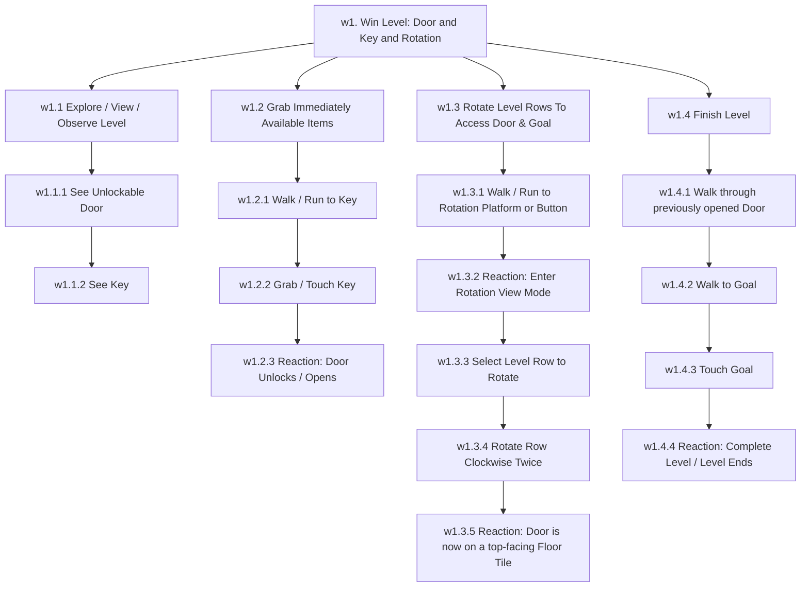
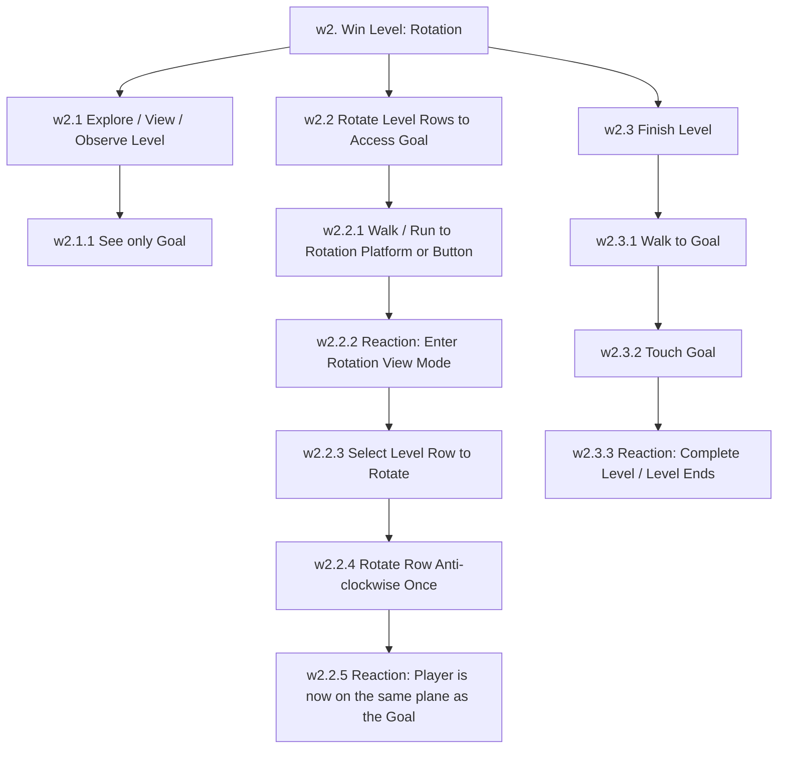
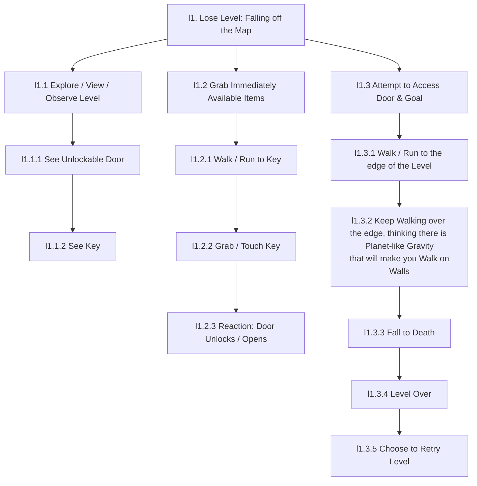

# Revolvium Use Cases 

### w1. Win Level: Door & Key & Rotation

### w2. Win Level: Rotation

### l1. Lose Level: Falling off the Map

---
# Notes from the Enda Class
### Use Cases
Use Cases are different win / lose cases of the game and its mechanics:
- Use Case 1-N: Player wins this way
- Use Case 2-N: Player loses by falling off map
- Use Case 3-B: Player loses this other way by mechanic

### UTSE
Usage Scenarios: Usability
Play Scenarios: Playability

### Specific Interactions
Run, Crawl, Walk, Grab Item, Push Button, Orientation (Figuring out Direction), Activate.
The player has to be engaged and understand.

### B / M / E
Stages of the Use Case: Begin / Middle / End.

### UCD
User-Centred Design like UX Profiles (Now HCD Human-Centred Design, PCD is specific Person-Centred Design like UX Personas).

### UD Principles
There's 7 principles
Size + Physical Space to Use
Physical Effort Exerted
Design for the Extreme Ends of Users
Innovation happens in the extremes

### GPF
Gameplay Features

### MoSCoW
Highly Prioritised Feature List
-> Mechanic: Do this first; Player Movement, Level Orienting
-> Control: Start with WASD, Arrows; Then specify the real controls in the game, all specific interactions a player can do; What's in their toolbelt / what's on their mind to use.
-> Collision Detection / Collision Reaction
-> Model / Level Design / Texture / Lighting
-> Sound
-> Score / Health / Time / State Variables
-> Win + Lose

![[Pasted image 20241002123249.png]]
